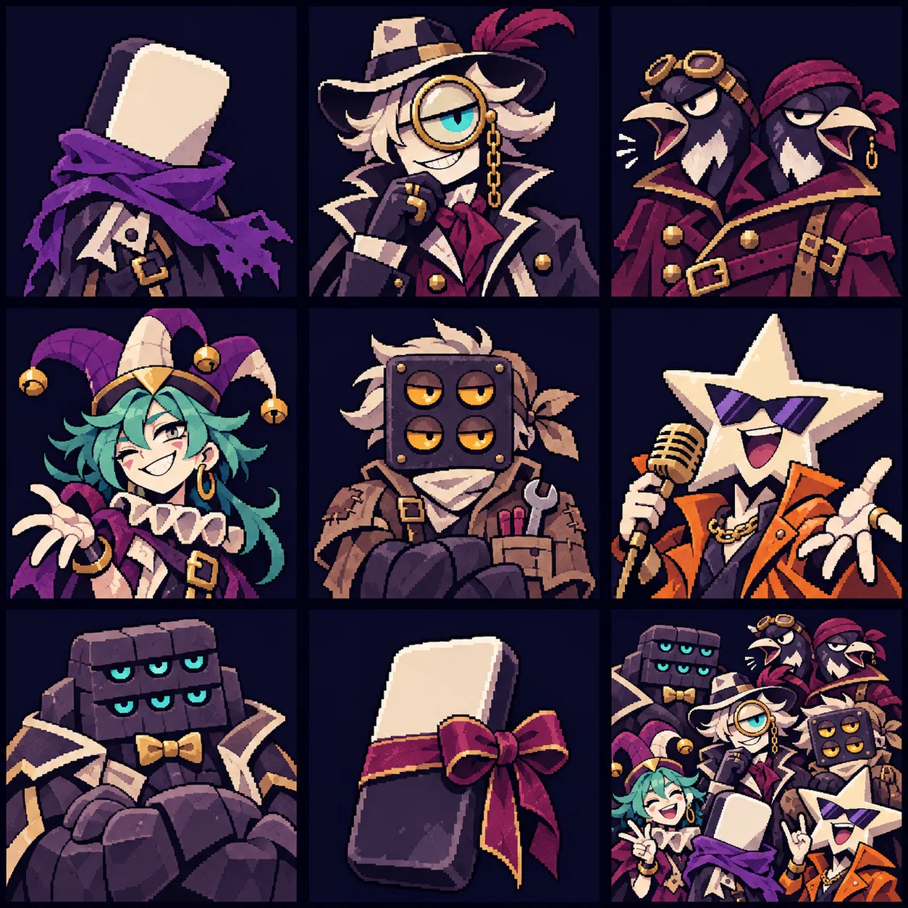

# Identidad coleccionable de Dominix

**Continuación más reciente:** [materiales, comparación A/B e Imperium](MATERIALS_IMPERIUM_2026-11-10.md), con 216 pruebas y un enfoque revisado hacia identidad material y numeración temática. Se conservan [Invitados del Umbral](HIGGSFIELD_INVITADOS_2026-11-10.md), los [37 emblemas propios y Chatarra de Lujo](CHARACTER_COLLECTIONS_2026-11-09.md). La [integración inicial de La Banda del Doble](BANDA_PACK_2026-11-09.md) documenta su primera entrega. El resto de este documento conserva el diagnóstico y la fase conceptual anterior; sus límites y cifras corresponden a aquella fase.

9 de noviembre de 2026. Rama `codex/dominix-stability-polish`, base `f2a8677d54ffdfa9c97cb55db0f12081c1369db2`. Continúa las mejoras de UI conservando la interfaz original. El usuario delegó la dirección creativa y pidió una propuesta que le sorprendiera, tomando como referencia el atractivo coleccionable de Balatro.

## Diagnóstico verificado

Las skins ilustradas actuales usan SVG de `react-icons/gi`, no emojis del sistema. Bestiario, Naturaleza, Mecánico, Tarot y Astral cambian el pictograma de cada valor, pero mantienen un tratamiento monocromo parecido. La nueva dirección necesita personajes, expresiones, materiales y una composición reconocible, además de variedad de símbolos.

En reliquias había un problema concreto: 80 entradas de catálogo, 63 asignaciones y **17 sin icono**, dibujadas como un círculo genérico por RelicCard. Tres pares compartían componente: Cadena Tensa/Parejas Perfectas, Tres Mágico/Tres Líneas y Maestro de Cadenas/Eternidad. Se conservaron los 60 símbolos de biblioteca restantes y se dibujaron **20 emblemas propios** para cubrir esos huecos y diferenciar los tres pares. El catálogo ahora tiene 80 componentes de icono distintos.

## Dirección propuesta: La Banda del Doble

Una primera colección de siete personajes propios: pícaros, expresivos, un poco teatrales. Pixel art de siluetas contundentes, marfil y obsidiana, ropa remendada, latón y acentos violeta, cian y rojo. La atmósfera de la mesa permanece azul tinta/violeta. La variedad cultural se expresa en los personajes; el marco del juego sigue siendo Dominix.

| Valor | Personaje provisional | Rasgo que lo identifica |
| --- | --- | --- |
| 0 | El Ausente | Máscara de dominó completamente vacía, bufanda violeta y postura desconfiada. |
| 1 | Monóculo | Un gran ojo cian, sombrero torcido y sonrisa de embaucador. |
| 2 | Los Picos | Dos contrabandistas urraca discutiendo dentro del mismo abrigo. |
| 3 | Trébol | Bufón de tres puntas, pelo turquesa y gesto de haber hecho trampa. |
| 4 | Cuatro Ojos | Mecánico con cuatro lentes ámbar en una máscara cuadrada. |
| 5 | Estrella Invitada | Cantante de cabeza estrellada, gafas y chaqueta naranja. |
| 6 | El Portero | Gólem de ladrillo con seis ojos cian y una pajarita demasiado pequeña. |

Esta es una **dirección de arte con lámina y maqueta QA**, todavía no una skin equipable. Los nombres son provisionales. La lámina no es un atlas final de producción: los retratos necesitan recorte y simplificación individual para leerse a tamaño de juego. No debe anunciarse como contenido desbloqueable ya terminado.

## Plan de producción acotado

1. **Una colección completa primero.** Producir siete retratos individuales coherentes, con versiones de cara para 36/48 px y versiones grandes de colección. Ilustración sin texto; valores, nombres y estados se dibujan en la UI. Afinar pixelado y alineación a una cuadrícula real durante la preparación final.
2. **Una prueba dentro de la mesa.** Registrar un nuevo identificador cosmético sin cambiar los IDs, desbloqueos ni elecciones guardadas actuales. Revisar una mano, una cadena y dobles con el pack entero. Los números deben seguir siendo claros sin memorizar a los personajes.
3. **Cuatro capas visuales.** Material de la ficha; retrato y valor; tipo especial (comodín, dorada, bomba, espejo, bloqueada); edición/pacto y estados de interacción. La personalización debe conservar las señales tácticas. Actualmente los tipos especiales suprimen la skin; su compatibilidad exige una implementación y prueba específicas.
4. **Colección que permita apreciar el arte.** Vista ampliada, los siete valores, ejemplo de mano y estados especiales antes de equipar. Mantener la estructura actual y aprovechar las presentaciones de desbloqueo existentes.
5. **Expandir por colecciones.** Después, Chatarra de Lujo (mechas reparados), Club del Eclipse (elenco de inspiración anime) e Invitados (homenajes elegidos expresamente). Cada pack necesita su propio reparto y materiales, con marcos y señales comunes del juego. Estas colecciones futuras no se han generado ni implementado.

Para las reliquias, los emblemas son la identidad de lectura rápida. Una futura ilustración de una reliquia destacada puede compartir esa silueta en recompensas/colección, mientras la versión pequeña sigue siendo clara en el HUD. No se sustituye de golpe todo el catálogo por retratos.

## Trabajo implementado en esta tanda

- `src/engine/relicEmblems.tsx`: veinte dibujos SVG originales de geometría fija, sin tipografías, filtros propios, descargas ni animaciones añadidas.
- `src/engine/relicIcons.ts`: 80 identidades explícitas; las 17 reliquias sin icono dejan de caer en el círculo genérico. Los tres pares repetidos quedan diferenciados.
- `src/components/TileView.tsx`: valores de las skins ilustradas de 7 px/55% de opacidad a **9 px en ficha pequeña y 10 px en mediana**, usando el color de acento completo. Se conservan los valores y el texto accesible de la ficha.
- `src/engine/relicIcons.test.ts`: cobertura del catálogo completo, componentes distintos y fallback seguro para un ID desconocido. La prueba detecta componentes compartidos, no puede certificar por sí sola que dos dibujos se distingan visualmente.
- `qa/uiIdentity.tsx`: galería de los veinte emblemas a tres tamaños de RelicCard, skins actuales y maqueta de siete fichas con los retratos conceptuales. Esta maqueta usa CSS sobre la lámina; no es TileView con una nueva skin registrada ni modifica partidas.

## Verificación y límites

**152 pruebas / nueve archivos** correctos; lint, build, TypeScript de producción y TypeScript QA correctos. Build: JS principal 460,14 kB / 123,77 kB gzip; CSS 123,98 kB / 19,25 kB gzip. Se mantiene el aviso existente de Browserslist. Sin dependencias nuevas ni cambios al lockfile.

En navegador se revisaron 60 instancias de emblemas (20 identidades × tamaños xs/sm/md) con los marcos reales de RelicCard. Galería a 1280 × 900 y 390 × 844; en móvil, ancho del documento 386 px y desplazable 386 px. Skins pequeñas revisadas con valores 0–6. No hay errores de aplicación en la ejecución QA final; permanece el aviso informativo de Framer Motion por movimiento reducido.

También se abrió Colección en la build de producción local: veinte emblemas propios presentes y veinte IDs visuales distintos en el DOM; consola sin avisos ni errores capturados. La partida que estaba abierta se conservó en su pestaña. La prueba conceptual confirmó siete fichas de muestra. El primer ensayo con bustos completos resultó demasiado denso a 48 px; la maqueta pasó a primeros planos mediante recortes CSS. Es una comprobación de composición, no validación de un atlas definitivo ni de legibilidad durante una partida con la nueva skin.

Capturas en `outputs/dominix-review`: `emblemas-propios-escritorio.jpg`, `emblemas-propios-movil.jpg`, `skins-valores-legibles-movil.jpg`. El concepto se conserva allí como PNG y WebP, además de la versión WebP incluida en esta documentación. Las capturas de la maqueta se registran aparte del catálogo real.

Evidencias adicionales: `emblemas-coleccion-real.jpg` (catálogo de producción) y `banda-del-doble-maqueta-qa.jpg` (concepto no equipable).

Pendientes: producción de los siete sprites, integración de un nuevo pack equipable, compatibilidad con tipos especiales/ediciones y revisión en dispositivos físicos. No se afirma que la colección nueva ya funcione dentro de una partida.

## Procedencia del concepto

Lámina creada con **ImageGen integrado** en esta sesión el 9 de noviembre de 2026, sin imágenes de referencia aportadas y sin consumir créditos de Higgsfield. Salida real PNG RGB de **1254 × 1254**, 2154331 bytes. Copia WebP de la misma resolución, calidad 85/método 6 con Pillow, **243326 bytes**, sin redimensionado. Archivo de documentación `docs/art/banda-del-doble-concept-v1.webp`; no se importa desde el producto. No se afirma exclusividad ni una licencia adicional sobre la salida generada. Los iconos GameIcons conservados mantienen su atribución previa CC-BY 3.0.

El prompt completo está en [art/banda-del-doble-v1.prompt.txt](art/banda-del-doble-v1.prompt.txt). Las últimas dos celdas de la lámina son una ficha de material y un retrato de grupo; las siete anteriores corresponden a los valores 0–6.
