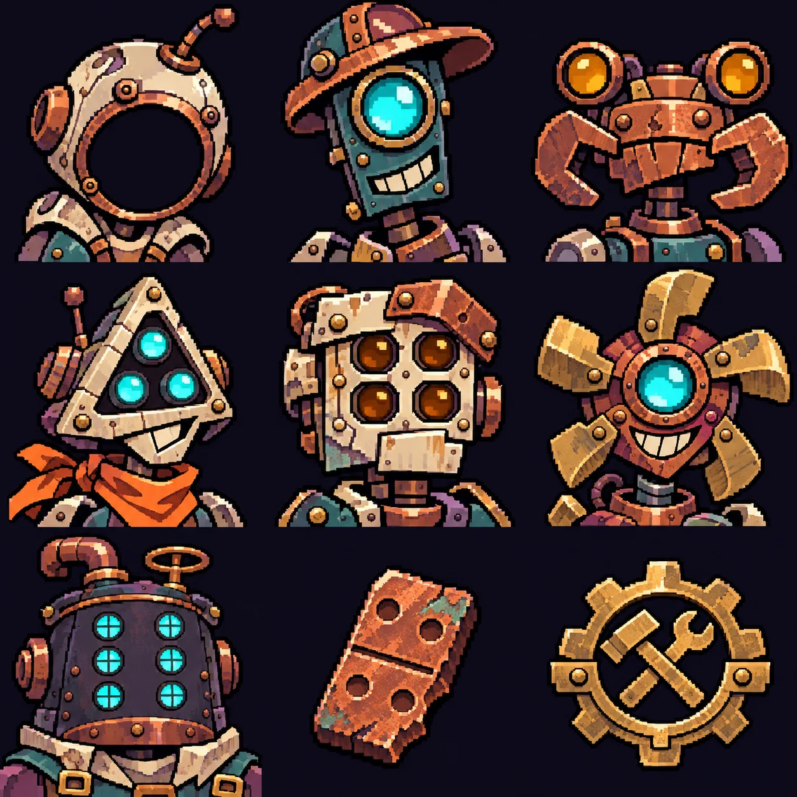

# Colecciones de personajes y diferenciación de reliquias

Continuación del 10 de noviembre: [Invitados del Umbral generado en Higgsfield, prueba de acabados y accesibilidad](HIGGSFIELD_INVITADOS_2026-11-10.md), con 195 pruebas. Este informe conserva la entrega previa de Chatarra y los 37 emblemas.

9 de noviembre de 2026. Rama `codex/dominix-stability-polish`; commit base `f2a8677d54ffdfa9c97cb55db0f12081c1369db2`. Cambios locales sin publicar. Continúa [La Banda del Doble](BANDA_PACK_2026-11-09.md) con autorización del usuario para ampliar skins e iconografía conservando la identidad actual.

## Implementado

**Chatarra de Lujo** (`chatarra_lujo`) es una segunda colección equipable de siete autómatas originales: Apagado (0), Farol (1), Pinza (2), Triciclo (3), Remache (4), Dínamo (5) y Caldero (6). Siluetas grandes, cobre gastado, esmalte petróleo, marfil y sensores cian sobre azul tinta; se mantiene el marco y la disposición de Dominix. Es gratuita desde el inicio, cosmética y sin ventajas jugables. El catálogo pasa de 17 a 18 skins; el perfil local de prueba dispone de 4/18.

**Visor de personajes en Colección → Skins:** dos selectores de colección; siete retratos seleccionables con valor, nombre y breve descripción; retrato de 96 px; ejemplos reales de TileView normal y dorada. Explorar no equipa ni escribe en el guardado. Equipar es una acción explícita y la skin activa queda señalada. Nombres, descripciones y controles disponibles en español e inglés. El catálogo anterior y su equipamiento directo se conservan debajo. Botones nativos con estado `aria-pressed`, imágenes con nombre accesible y ejemplos estáticos sin botones anidados. No se añade un modal ni una nueva secuencia de animación.

**17 emblemas SVG adicionales de reliquia**, ahora **37 propios en total**. La auditoría de asignaciones mostró que 17 reliquias seguían compartiendo exactamente el componente de icono de un patrón. Eso era un solapamiento demostrado por código; su grado de confusión era una decisión visual, no un fallo de puntuación. Se conservaron los iconos de los patrones y se diferenciaron las reliquias: Eco Par, Cadena Tensa, Precisión, Dominio Total, Tres Mágico, Cadena Maestra, Racha Imparable, Minimalista, Maestro de Cadenas, Reflejo, Pureza Doble, Avalancha Total, Caída Prolongada, Coronación, Hexagrama Sagrado, Eco Roto y Armonía Divina. Sus colores, categorías, marcos, IDs y efectos no cambian.

Hay 80 asignaciones explícitas de reliquia distintas y ninguna reutiliza un componente de los 31 patrones. La regresión comprueba identidades de componentes; la distinción visual exige también inspección de los dibujos.

## Recursos y procedencia

- Lámina creada con **ImageGen integrado**, una generación nueva, sin referencias visuales externas ni personajes de franquicias. No se consumieron créditos de Higgsfield en esta tanda. Se utilizó la herramienta disponible para crear ilustración; los emblemas son dibujos SVG en código, sin generación de imágenes.
- Fuente exacta PNG RGB **1254 × 1254, 2036211 bytes**, archivada en `outputs/dominix-review/chatarra-de-lujo-source-v1.png` del workspace. Se conserva también una copia WebP de documentación en `docs/art/chatarra-de-lujo-concept-v1.webp`; no entra en el producto. Prompt completo: [art/chatarra-de-lujo-v1.prompt.txt](art/chatarra-de-lujo-v1.prompt.txt).
- Atlas de producto `src/assets/skins/chatarra-portraits-v1.webp`: **672 × 96**, siete cuadros de 96 px, **43054 bytes**, paleta de 128 colores y WebP sin pérdida. Preparación mecánica por recorte, vecino más cercano y cuantización, sin redibujar el arte ni añadir texto. Los valores se presentan en HTML. La lámina completa y sus dos celdas auxiliares no se cargan durante una partida.
- Metadatos de fuente, recortes y hashes de cuadros en `src/assets/skins/chatarra-portraits-v1.json`. Exportación reproducible: `python tools/prepare_chatarra_atlas.py SOURCE_PNG OUTPUT_WEBP`, usando Pillow ya disponible para preparar recursos; ninguna dependencia nueva del juego. El exportador compartido también reconstruyó La Banda del Doble con SHA-256 idéntico al atlas existente (`9e29997ca582711abd01efb9168819a7aabdaf3506d97c8d388c365f310d9916`).
- No se afirma exclusividad ni una licencia adicional sobre las imágenes generadas. Los iconos de biblioteca que permanecen mantienen la atribución GameIcons CC-BY 3.0. Los nuevos emblemas no usan tipografías, imágenes, filtros ni IDs SVG compartidos.

## Verificación automatizada

**184 pruebas en once archivos**, todas correctas, incluyendo doce pruebas nuevas de colecciones y una de separación de símbolos entre patrones y reliquias. Se verifican disponibilidad sin ventajas ni sustitución de selección, siete personajes localizados por pack, valores explícitos de Chatarra en seis tipos y dos tamaños con edición/pacto, inicio del visor en la colección activa y ausencia de equipamiento al renderizar/explorar inicialmente.

Lint, TypeScript de producción, TypeScript QA y compilación correctos. La primera ejecución de Vitest no pudo iniciar las pruebas por un error EPERM del directorio temporal de la sandbox; se repitió fuera de esa restricción y pasó la suite completa. No fue un fallo de las reglas del juego.

Build: JS principal **468,35 kB / 126,01 kB gzip**, CSS **126,87 kB / 19,66 kB gzip**, Colección **15,69 kB / 5,28 kB gzip**. Atlas nuevo separado de **43,05 kB**. Persiste el aviso previo de Browserslist. Sin cambios de dependencias o lockfile. `git diff --check` correcto, con aviso de normalización futura LF/CRLF en HomeScreen.

## Verificación en navegador

Se reiniciaron los servidores locales de producción (`127.0.0.1:5176`) y QA (`127.0.0.1:5178`); ambos respondieron HTTP 200. Las otras partidas abiertas no se recargaron. Una pestaña QA anterior quedó en error al recargarse antes de que el servidor estuviera activo; las comprobaciones finales usaron pestañas nuevas conectadas.

**Producto real:** selección inicial Clásica; explorar Chatarra y seleccionar Caldero no alteró esa selección. Equipar mediante el botón explícito cambió el estado activo y se mantuvo tras volver al inicio y recargar. Se revisó el visor a **1280 × 900** y **390 × 844**. En móvil, ancho del documento y desplazable **386 px**, sin desbordamiento; cero botones anidados en la pantalla. Se seleccionaron retratos y se comprobaron sus ejemplos normal/dorado.

Después se inició Endless con el Arquitecto, semilla **ZGGPVA**, skin Chatarra, 50 oro, 12 acciones y siete fichas. Colocar `0|1`, `1|4` y `2|4` produjo **35 → 45 → 80**, Cadena Simple y extremos 0/2. Deshacer recuperó 45 y diez acciones; repetir la tercera colocación volvió a 80 y nueve acciones. Robar dejó ocho acciones, reserva 20 y cinco fichas; descartar `0|3` con el puntero dejó siete acciones, un descarte y cuatro fichas, conservando los 80 puntos. Se revisó también la mesa y la mano a 390 × 844, sin desbordamiento. La run se dejó abierta y no se completó ni generó XP o historial. La elección global se restauró a Clásica mediante el inicio, manteniendo Chatarra en la partida de prueba ya montada.

**QA de componentes:** galería con 37 emblemas × tres tamaños, **111 instancias SVG propias**. Revisión visual de los nuevos dibujos, retratos pequeños y medianos, y seis tipos de Chatarra combinados con ediciones y pacto. Visor comprobado en español/inglés, incluyendo Caldero/Boiler y Triciclo/Tricycle. Movimiento reducido activado en el host QA. La galería usa componentes reales y datos artificiales; no acredita una partida natural con todas esas combinaciones.

Consola de producción capturada sin avisos ni errores; QA solo mostró el aviso informativo de Framer Motion por movimiento reducido. La escala efectiva del navegador era 1,58: las dimensiones se comprobaron leyendo `innerWidth/innerHeight` y los anchos del documento, no suponiéndolas a partir del tamaño solicitado. Las capturas finales compensan esa escala y muestran el encuadre completo.

## Capturas y registros

En `outputs/dominix-review` del workspace:

- `chatarra-visor-escritorio.jpg`: Colección real, Dínamo y siete personajes, 1280 × 900.
- `chatarra-visor-movil.jpg`: el mismo visor a 390 × 844.
- `chatarra-partida-real-movil.jpg`: partida natural a 80 puntos, cadena y mano.
- `chatarra-fichas-especiales-qa-movil.jpg`: seis tipos, ediciones y pacto en la galería QA.
- `reliquias-emblemas-distintos-1.jpg` y `reliquias-emblemas-distintos-2.jpg`: revisión de los nuevos dibujos con sus marcos reales.
- `chatarra-consola.json`: consola de producción y QA separadas.

## Archivos principales

Nuevos: `src/components/SkinShowcase.tsx`, `SkinShowcase.test.tsx`, `src/engine/skinCharacters.ts`, `chatarraArt.tsx`, atlas/JSON de Chatarra, `tools/prepare_chatarra_atlas.py`, lámina/prompt e informe. Modificados: `CollectionScreen.tsx`, `HomeScreen.tsx`, `TileView.tsx`, `tileSkins.tsx`, `progression.ts`, `i18n.ts`, `i18nContent.ts`, `relicEmblems.tsx`, `relicIcons.ts`, `relicIcons.test.ts`, exportador de La Banda, galería QA y documentación. La preparación compartida se acota a exportación de recursos; no refactoriza reglas del juego.

## Pendientes

Dispositivos físicos, medición de FPS en hardware modesto, una run completa con Chatarra y combinaciones exhaustivas con jefes/talentos. La nueva galería prueba presentación, no balance ni economía. Los iconos de biblioteca conservados no han recibido un redibujo global. No se han creado packs de invitados de franquicias ni nuevas funciones de guardado. El siguiente paso lógico es definir una colección de invitados con personajes elegidos y una dirección reconocible, antes de generar más arte; no se implementó en esta entrega.
