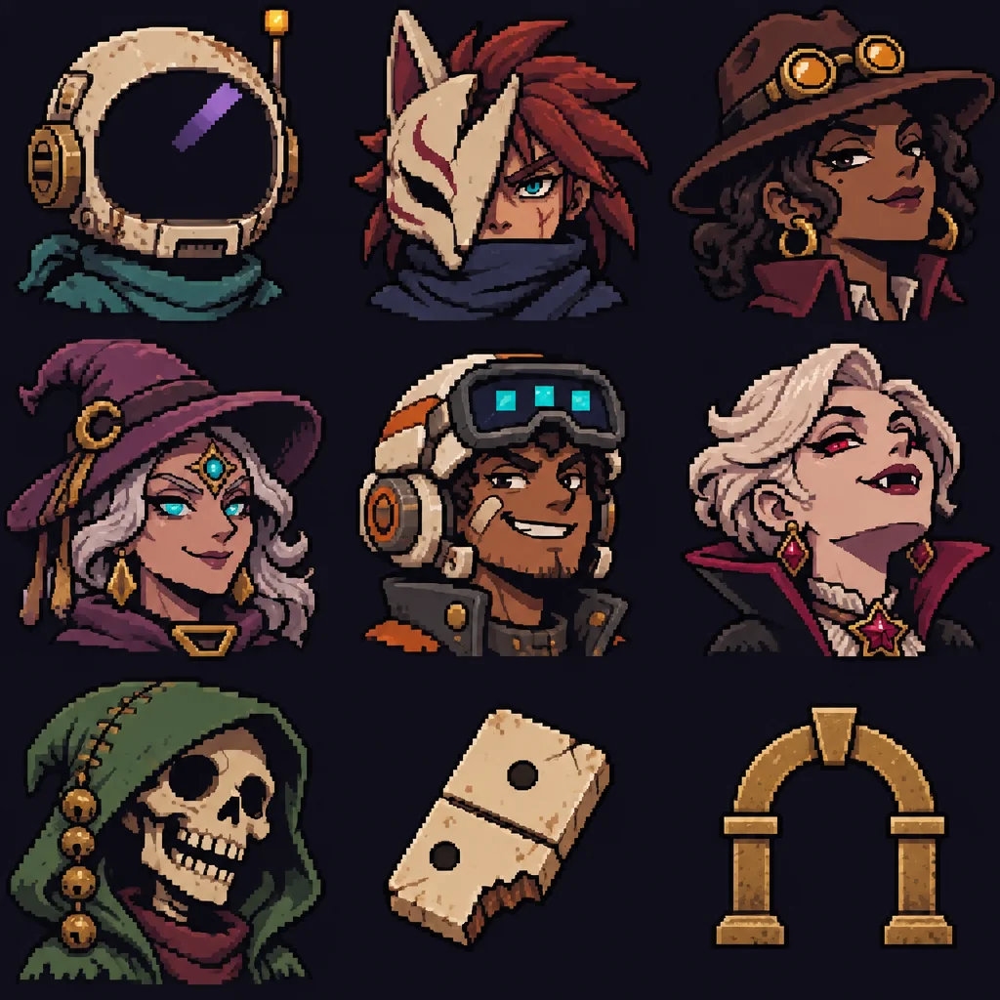

# Invitados del Umbral y previsualización de acabados

Continuación posterior: [mejora de materiales e Imperium con comparación A/B](MATERIALS_IMPERIUM_2026-11-10.md), a partir de la revisión del usuario sobre el sentido de las últimas skins. Este informe conserva las evidencias de la entrega de Invitados.

Trabajo iniciado el 9 y cerrado el **10 de noviembre de 2026**, hora de Berlín. Rama `codex/dominix-stability-polish`, commit base `f2a8677d54ffdfa9c97cb55db0f12081c1369db2`. Cambios locales sin publicar. Continúa [las colecciones y los emblemas](CHARACTER_COLLECTIONS_2026-11-09.md), conservando la UI original.

## Resultado

**Invitados del Umbral** (`invitados_umbral`) es la tercera colección original equipable: siete viajeros de géneros distintos, con pixel art de contornos fuertes, marfil, violeta, petróleo, latón y acentos cian/burdeos. Cada personaje conserva un número explícito en HTML. El catálogo tiene ahora 19 skins; el perfil local de prueba dispone de 5/19. Las tres colecciones de personajes suman 21 retratos y son gratuitas desde el inicio, sin ventajas jugables. Los 37 emblemas propios de reliquia de la entrega anterior se conservan.

| Valor | Personaje | Silueta |
| --- | --- | --- |
| 0 | La Náufraga | Casco espacial circular y visor negro. |
| 1 | El Ronin | Máscara rota y pelo rojizo. |
| 2 | La Sabueso | Sombrero ancho, gafas ámbar y pendientes. |
| 3 | La Vidente | Sombrero violeta y joya turquesa. |
| 4 | El Piloto | Casco tecnológico y visor cian. |
| 5 | La Carmesí | Pelo blanco, ojos carmesí y cuello alto. |
| 6 | El Errante | Calavera sonriente y capucha verde. |

Son personajes originales de géneros reconocibles; no se presentan como colaboraciones oficiales ni personajes de franquicias. La Vidente se denominaba La Oráculo en el prompt conceptual; el nombre de producto se afinó durante la integración. Los números de juego no dependen de contar luces o adornos del dibujo.

**Probar fichas especiales y acabados**, dentro de Colección → Skins, es una sección plegable del visor. Permite comparar seis tipos, cuatro ediciones o ninguna y Pacto Sagrado en tamaños mediano y pequeño. Los mismos ajustes se conservan al comparar las tres colecciones; cambiar de colección reinicia la cara seleccionada a cero. La vista previa no modifica inventario, progresión ni descubrimientos y no equipa automáticamente. El botón Equipar sigue siendo explícito. La descripción del personaje se anuncia mediante una región accesible de actualización moderada.

## Problemas adicionales comprobados

- **Reproducido visualmente:** los contadores de las pestañas de Colección se recortaban a 390 px. Etiqueta y contador se apilan en móvil y permanecen en una línea en escritorio. Se añadió nombre accesible explícito y estado seleccionado; las barras de esas pestañas respetan movimiento reducido.
- **Reproducido en navegador y demostrado en código:** con los controles en inglés, TileView aún anunciaba tipo, valores, pacto y edición en español. Las etiquetas completas ahora usan i18n; se verificó `Mirror, Tile 0 6, with Sacred Pact, negative edition` y su versión española al cambiar de idioma. El texto español existente se conserva.
- **Decisión de diseño:** la nueva colección se ofrece como cosmético gratuito. No se añadió un sistema de desbloqueos, una moneda ni una migración para justificar el contenido visual.

## Higgsfield: trabajo y consumo reales

Se utilizó la integración conectada de Higgsfield, con consulta de saldo, capacidades, preferencia de proyecto y cotización antes de generar. La preferencia era `auto_create_project: false`; no se creó un proyecto externo. El usuario autorizó expresamente **una lámina por 0,25 créditos**. Se envió un único trabajo, sin referencias externas ni variantes adicionales:

- Modelo: `gpt_image_2_6`, proporción 1:1, una imagen, parámetros de calidad/resolución por defecto.
- Trabajo completado: `7513bd72-4f7e-4e09-a80e-11bf38203148`.
- Saldo previo **109**; posterior **108,75**. Consumo comprobado **0,25 créditos**.
- El estado consultado indicaba fin de prueba el 11 de noviembre, sin ilimitadas disponibles. No se activó ni contrató ningún servicio.
- El resultado se mostró mediante el widget de generación existente y se descargó al workspace para su integración; no se volvió a generar para obtener una copia.

Los plugins ya conectados y las herramientas locales cubrieron esta entrega. La implementación y la revisión de UI se realizaron sobre el repositorio con terminal y navegador; no se trasladó el juego a un constructor alojado.

## Archivos gráficos y preparación

Fuente PNG RGB de **1024 × 1024**, **1287258 bytes**, archivada en `outputs/dominix-review/invitados-del-umbral-source-v1.png`. Copia WebP de documentación, misma resolución, calidad 85/método 6, **115480 bytes**, en `docs/art/invitados-del-umbral-concept-v1.webp`. Ninguna lámina grande se importa desde el producto.

Atlas real de producto: `src/assets/skins/invitados-portraits-v1.webp`, **672 × 96**, siete cuadros de 96 px, paleta de 128 colores y WebP sin pérdida, **42358 bytes**. Se preparó mecánicamente mediante recortes, vecino más cercano y cuantización; no hubo retoque creativo ni generación extra. El atlas se usa en fichas de 36/48 px y en el retrato de colección de 96 px. Se conservan los valores, señales de tipo y edición/pacto encima del arte.

`src/assets/skins/invitados-portraits-v1.json` registra hash de la fuente, recortes y hashes de los siete cuadros distintos. `tools/prepare_invitados_atlas.py` reproduce la exportación con Pillow ya disponible; el exportador compartido admite la dimensión esperada explícita y exige siete nombres/recortes. La reconstrucción de La Banda del Doble sigue produciendo exactamente el mismo SHA-256 que antes. [Prompt completo](art/invitados-del-umbral-v1.prompt.txt).

No se afirma exclusividad ni una licencia adicional sobre la salida generada. Las atribuciones de iconos de biblioteca conservados continúan en el proyecto. Esta tanda no sustituye ni regenera los emblemas SVG anteriores.

## Pruebas y compilación

**195 pruebas / once archivos**, todas correctas. Nuevas coberturas: tercera colección con siete nombres en ambos idiomas; valores explícitos en seis tipos y dos tamaños con edición/pacto; controles de muestra inicialmente plegados, sin escrituras de selección/XP/descubrimientos al renderizar; etiquetas completas de ficha en inglés. La interacción real de los controles se comprobó además en navegador, porque el render estático no verifica eventos ni estados después de una elección.

Lint, TypeScript de producción, TypeScript QA, build y `git diff --check` correctos. Sin dependencias nuevas ni modificaciones al lockfile. Permanece el aviso previo de Browserslist y la advertencia de normalización LF/CRLF en HomeScreen.

Build final: JS principal **471,00 kB / 126,62 kB gzip**; CSS **128,06 kB / 19,82 kB gzip**; Colección **18,89 kB / 6,29 kB gzip**; atlas nuevo separado **42,36 kB**. Son tamaños de salida, no una medición de FPS o rendimiento de hardware.

## Comprobación en navegador

Producción local `127.0.0.1:5176` y galería QA separada `127.0.0.1:5178`, ambos con respuesta HTTP 200. Se probó una pestaña nueva; las partidas anteriores no se recargaron.

**Visor de producto:** selección inicial Clásica. Explorar Invitados, cambiar de personaje, seleccionar los seis tipos y las cinco opciones de acabado y activar pacto mantuvo Clásica y el contador de ediciones en **0/4**. Las etiquetas accesibles reflejaron las seis identidades y cada edición. Se compararon las tres colecciones con dorada/policromada/pacto conservando los ajustes. Se comprobó teclado, tamaños de muestra y controles nativos. En móvil **390 × 844**, ancho visible y desplazable **386 px**, sin desbordamiento, y cero botones anidados. La captura móvil final muestra los cuatro contadores completos. Se revisó también a 1280 × 900 durante el desarrollo; la captura final de escritorio es de **1600 × 1125**, dimensiones verificadas tras el cambio de escala efectiva del navegador.

**Equipamiento y partida reales:** el botón Equipar activó Invitados del Umbral. Volver al inicio y recargar conservó esa selección. Se inició Endless con el Arquitecto, semilla **LVZSE1**, 50 oro, 12 acciones y siete fichas con el nuevo atlas.

1. Colocar `0|2`, `0|4` y `1|4` produjo **35 → 45 → 80**, Cadena Simple, extremos 1/2 y nueve acciones. Deshacer recuperó 45 y diez acciones; repetir la tercera colocación volvió a 80.
2. Robar dejó ocho acciones, reserva 20 y cinco fichas. Descartar `3|3` con el puntero dejó siete acciones, un descarte y cuatro fichas, conservando los 80 puntos. Mano y cadena seguían mostrando el nuevo pack.
3. Cerrar presentó **Total 80**, meta 80 y **+18 oro**. Tras abrir recompensas y saltarlas, la ronda 2 empezó con **68 oro**, doce acciones, siete fichas, siete instancias del atlas y catorce valores en HTML. La run se dejó abierta en esa ronda; no se completó.

La selección global se restauró a Clásica tras montar la partida de prueba; la partida conserva Invitados. En el inicio previo al cierre se mantuvieron dos runs registradas, nivel 3 y 193/200 XP. La galería QA verificó inglés/español y movimiento reducido; las muestras no acreditan una partida natural con todos los tipos y ediciones.

Consola de producción capturada sin avisos ni errores. QA solo mostró el aviso informativo de Framer Motion por movimiento reducido. No se observaron errores nuevos de aplicación durante los flujos modificados.

## Evidencias

En `outputs/dominix-review` del workspace:

- `invitados-coleccion-escritorio.jpg`: skin equipada, retratos y catálogo real, 1600 × 1125.
- `invitados-acabados-movil.jpg`: visor y controles reales desplegados, ancho 390 px, captura del contenido vertical completo.
- `invitados-partida-real-movil.jpg`: cadena de 80 puntos y mano durante la primera ronda.
- `invitados-consola.json`: registros de producción y QA.
- `invitados-del-umbral-source-v1.png`: fuente exacta descargada de Higgsfield.

## Archivos principales y límites

Nuevos: `src/components/SkinTilePreview.tsx`, `src/engine/invitadosArt.tsx`, atlas y JSON, exportador y documentación/prompt. Modificados: `SkinShowcase.tsx`, `SkinShowcase.test.tsx`, `CollectionScreen.tsx`, `TileView.tsx`, `HomeScreen.tsx`, `tileSkins.tsx`, `skinCharacters.ts`, `progression.ts`, `i18n.ts`, `i18nContent.ts`, exportador compartido y galería QA. No se refactorizaron reglas de puntuación o inventario ni se cambiaron claves de guardado.

Pendientes: dispositivos físicos, medición de FPS, una run completa con esta skin y combinación exhaustiva con jefes/talentos. No hay una colección oficial de personajes de terceros, una reanudación nueva de partidas ni una publicación remota. El siguiente paso lógico es evaluar si alguna familia de iconos de biblioteca necesita redibujarse a partir de observaciones de juego; no añadir otra colección sin revisar primero estas tres a tamaño real.
