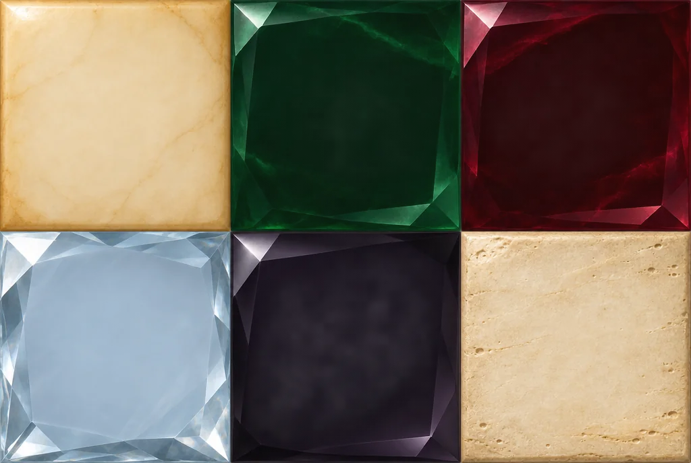
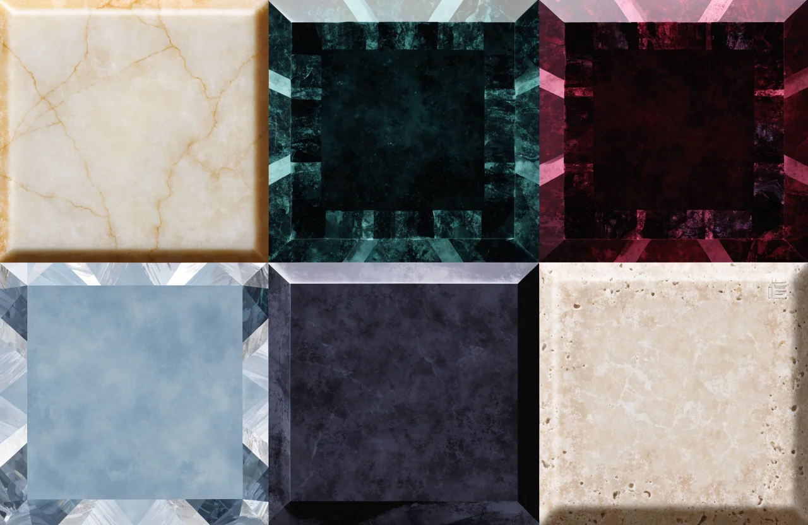

# Materiales, comparación de modelos e Imperium

10 de noviembre de 2026. Rama `codex/dominix-stability-polish`, base `f2a8677d54ffdfa9c97cb55db0f12081c1369db2`. Cambios locales, sin publicar. Continúa [Invitados y el visor de acabados](HIGGSFIELD_INVITADOS_2026-11-10.md), siguiendo la petición de mejorar materiales y crear una skin romana sin sustituir la UI.

## Criterio artístico

La última colección de viajeros aportaba retratos correctos, pero un tema débil como conjunto dentro de Dominix. Es una valoración de dirección artística, no un error de software. Se conservó el trabajo y su selección guardada; esta tanda se centró en materiales identificables y una numeración temática coherente. La paleta, portada, tipografía general, mesa y controles del juego mantienen su estructura.

Higgsfield es la plataforma de acceso a modelos. La primera lámina de Invitados había usado GPT Image 2.6 con calidad predeterminada baja. Aquí se comparó una configuración alta del mismo modelo con otro modelo, a partir de **un prompt idéntico**, y después bajo los mismos puntos y números del componente real. El resultado elegido es mejor para estos materiales según la inspección realizada; no acredita superioridad universal de un proveedor.

## Comparación real y consumo autorizado

El usuario autorizó dos muestrarios por un máximo total de **2,75 créditos**. Se cotizaron los parámetros finales antes de enviarlos y se completó exactamente un trabajo por configuración:

| Variante | Configuración | Trabajo | Créditos |
| --- | --- | --- | --- |
| A | `gpt_image_2_6`, calidad `high`, resolución `1k`, proporción solicitada 3:2 | `ce0a7d67-9e5f-4619-83d0-33574183d88a` | 1,50 |
| B | `recraft_v4_1`, variante `utility`, resolución `1k`, proporción solicitada 3:2 | `455701ed-1e4f-4bb1-9f24-fd98dc43db20` | 1,25 |

Saldo consultado: **108,75 → 106 créditos**. No hubo otra generación, suscripción ni variante adicional. Preferencia existente de no crear proyecto externo conservada.

**Elegida A:** centros más tranquilos, facetas amplias y menos ruido entre los puntos. B produjo zonas de veta más contrastadas y facetas pequeñas y cuadriculadas en Esmeralda/Rubí; la piedra incluyó una marca no solicitada. En Marfil y Diamante ambas alternativas resultaron utilizables, pero A dio una familia más uniforme. B se conserva en QA para comparación, no se importa desde el producto.

| A · GPT Image 2.6 alta | B · Recraft Utility |
| --- | --- |
|  |  |

[Prompt completo](art/materials-ab-v1.prompt.txt) y [trabajos, costes y hashes](art/materials-ab-v1.json).

## Mejoras integradas

- **Marfil:** veta cálida, borde de resina/piedra pulida, bisel y puntos oscuros con tratamiento hundido.
- **Esmeralda y Rubí:** superficies oscuras con cortes grandes y puntos claros de material; el cambio va más allá del color plano.
- **Obsidiana:** vidrio oscuro con planos y brillo lateral plateado; mantiene sus puntos cuadrados.
- **Diamante** (`diamond`): nueva skin de cristal azul frío, refracciones periféricas y puntos de grafito con forma de rombo. No existía como entrada de catálogo independiente.
- **Imperium** (`imperium`): nueva skin inspirada en piedra romana, meandros y hojas de laurel. Números **I, II, III, IV, V, VI** dibujados como texto HTML; el cero se representa con un **sello vacío** y su equivalencia numérica. No se inventa un numeral romano cero. El número arábigo pequeño permanece como ayuda táctica y las descripciones accesibles anuncian los valores del juego.

Las dos skins nuevas son cosméticas y gratuitas. Los IDs y desbloqueos existentes se conservan: Obsidiana nivel 3, Esmeralda 6, Rubí 9 y Marfil 11. El catálogo pasa de 19 a **21**; el perfil de prueba dispone de **7/21**. No se cambiaron claves de guardado, inventario o reglas de puntuación.

El material permanece reconocible en tipos especiales, con intensidad reducida para dar prioridad a sus colores y marcadores. Imperium conserva los numerales en comodines, doradas, espejos, bombas y bloqueadas; el contraste cambia con el fondo del tipo. Pacto, edición y bloqueo mantienen sus señales encima. Los puntos y números están en capas separadas de las texturas. Biseles y superficies son estáticos, sin animaciones o filtros nuevos por ficha.

**Visor de Colección:** el mismo panel distingue ahora «Materiales y símbolos» de «Personajes». Con una selección clásica, abre Marfil; con una selección material o ilustrada válida, abre su familia. Permite inspeccionar materiales bloqueados sin desbloquearlos y muestra el nivel necesario en el botón deshabilitado. El cambio de familia/valor solo modifica la vista previa; equipar sigue siendo explícito. Las colecciones de personajes anteriores permanecen disponibles. Esto evita que los retratos sean la única entrada al visor.

## Recursos reales y tamaño

Fuentes PNG archivadas en `outputs/dominix-review` del workspace:

- `materials-a-gpt-high-v1.png`: RGBA, **1024 × 688**, **1067928 bytes**.
- `materials-b-recraft-utility-v1.png`: RGB, **1280 × 832**, **1770278 bytes**.

Las dimensiones reales difieren ligeramente de la proporción solicitada; los recortes se calcularon sobre las dimensiones recibidas, en tres columnas y dos filas. No se deformó una UI ni se incrustó texto generado en las fichas.

`tools/prepare_material_surfaces.py` reproduce recortes, redimensionado mecánico Lanczos a **96 × 192**, compresión WebP calidad 82/método 6 y metadatos. No retoca creativamente los resultados. Las seis superficies A en `src/assets/materials` suman **7768 bytes**: Marfil 992, Esmeralda 1136, Rubí 1124, Diamante 1724, Obsidiana 750 y piedra romana 2042. Son suficientemente pequeñas para que Vite las incluya como URL de datos en el JS; no añaden seis peticiones de red separadas.

Las seis B suman **13514 bytes** y se importan solo desde `qa/uiMaterials.tsx`, mediante una variable CSS de previsualización. El mismo TileView dibuja puntos, dimensiones y numerales en A/B. Las fuentes completas no se cargan en el producto. Copias WebP documentales: A **167206 bytes**, B **104710 bytes**. Metadatos de hashes/recortes en los JSON de ambas carpetas.

Ornamento romano, sello vacío y numerales fueron desarrollados en código (`materialArt.tsx`), separados del material generado. No se afirma exclusividad ni una licencia adicional sobre las salidas de los modelos. Se conservan las atribuciones de biblioteca anteriores.

## Pruebas automatizadas

**216 pruebas en doce archivos**, todas correctas. Veintiuna regresiones nuevas protegen equivalencia de valores 0–6 con I–VI/sello vacío, numerales en seis tipos y dos tamaños, ediciones/pacto, identidad de materiales sin mutar fichas, desbloqueos antiguos, selección guardada e inspección de un material bloqueado sin equipamiento. La prueba anterior del visor se actualizó para su entrada inicial de materiales; el pack activo ilustrado continúa abriendo su familia.

Lint, TypeScript de producción, TypeScript QA, build y `git diff --check` correctos. Sin dependencias nuevas ni cambios de lockfile. Se mantienen los avisos previos de Browserslist y normalización LF/CRLF en HomeScreen.

Build: JS principal **485,30 kB / 137,07 kB gzip**, CSS **130,67 kB / 20,27 kB gzip**, Colección **20,27 kB / 6,59 kB gzip**. El JS incluye las pequeñas imágenes de material. Estos tamaños no equivalen a medir FPS ni acreditan rendimiento en teléfonos físicos.

## Navegador: probado y límites

Producción local `127.0.0.1:5176` y QA separada `127.0.0.1:5178` respondieron HTTP 200.

**Comparación A/B:** nueva pestaña «Materiales A/B» del host QA, seis pares de materiales, TileView mediano y pequeño con valores 1/6. Se inspeccionaron la claridad de los puntos y los reflejos. La galería añade los siete valores de Imperium y seis tipos con ediciones/pacto. Son datos artificiales de presentación, no una partida natural con todas las combinaciones. Se guardaron capturas de la comparación y de los numerales/estados. El host tenía movimiento reducido activado.

**Colección real a 390 × 844:** ancho del documento y desplazable **386 px**, sin desbordamiento horizontal; cero botones anidados. Se revisaron Marfil, Diamante e Imperium y el cambio entre familias. Marfil permaneció bloqueado al nivel 11, Clásica siguió activa mientras se exploraba y el contador de ediciones siguió **0/4** tras elegir acabados/pacto. Se recorrieron los seis tipos en la muestra romana y sus etiquetas accesibles. Equipar Imperium, volver al inicio y recargar conservó la selección. La escala efectiva del navegador varió durante la sesión; se verificaron dimensiones reales de DOM antes de tomar las capturas móviles finales, sin confundirlas con los valores solicitados a la herramienta.

**Partida real:** Endless con el Arquitecto, semilla **7JOHHO**, 50 oro, doce acciones y siete fichas romanas.

1. `0|2`, `0|3` y `2|4` produjeron **35 → 45 → 80**, Cadena Simple y extremos 3/4. Deshacer recuperó 45 y diez acciones; repetir la tercera colocación volvió a 80 y nueve acciones.
2. Robar dejó ocho acciones, reserva 20 y cinco fichas. Descartar `1|1` con el puntero dejó siete acciones, un descarte y cuatro fichas, conservando los 80 puntos.
3. Cerrar mostró **Total 80**, meta 80 y **+18 oro**. Apareció el evento natural **Bonus Inesperado**: 25 puntos para la siguiente ronda. Continuar abrió recompensas; saltarlas inició la ronda 2 con **68 oro**, **25 puntos**, doce acciones, siete fichas romanas y catorce números auxiliares.
4. En ronda 2, colocar `0|2` dio **60**; deshacer regresó a **25**, conservando el evento. Se dejó esa run abierta sin finalizarla.

La selección global se restauró a Clásica mediante otra pestaña de inicio tras montar la partida; Imperium permanece en su run de prueba. El inicio consultado conservaba dos runs registradas, nivel 3 y 193/200 XP. Las partidas anteriores se conservaron sin recargar.

Consola de producción capturada sin avisos ni errores. QA solo mostró el aviso informativo de Framer Motion por movimiento reducido. No se afirma validación de todas las combinaciones de jefes, reliquias y talentos, una run completa ni pruebas en hardware físico.

## Evidencias y archivos principales

En `outputs/dominix-review`:

- `materiales-ab-marfil-gemas.jpg`: comparación de materiales con los componentes reales.
- `imperium-valores-y-estados.jpg`: siete valores y estados especiales en QA.
- `marfil-material-movil.jpg`: Marfil, visor y bloqueo original de nivel.
- `diamante-coleccion-movil.jpg`: skin Diamante en el visor real.
- `imperium-coleccion-movil.jpg`: numerales, decoración, ayuda del cero y equipamiento.
- `imperium-partida-real-movil.jpg`: cadena de 80 puntos y mano en una partida natural.
- `materiales-imperium-consola.json`: registros separados de producto y QA.

Nuevos: `src/engine/materialArt.tsx`, `src/assets/materials/*`, `src/components/MaterialSkins.test.tsx`, `tools/prepare_material_surfaces.py`, `qa/uiMaterials.tsx`, `qa/assets/materials-b/*`, fuentes documentales, prompt y registro A/B. Modificados: `TileView.tsx`, `SkinShowcase.tsx`, `SkinShowcase.test.tsx`, `tileSkins.tsx`, `progression.ts`, `i18n.ts`, `i18nContent.ts`, `HomeScreen.tsx` (colores del selector), `src/index.css`, host QA y documentación.

Pendientes: dispositivos físicos, medición de FPS, run completa y revisión de una mano natural de Marfil/Esmeralda/Rubí a sus niveles de desbloqueo. Estas se revisaron visualmente en componentes reales sin alterar el progreso para equiparlas. Próximo paso lógico: una sesión de juego centrada en la lectura de estos materiales y los estados de edición antes de producir más colecciones.
